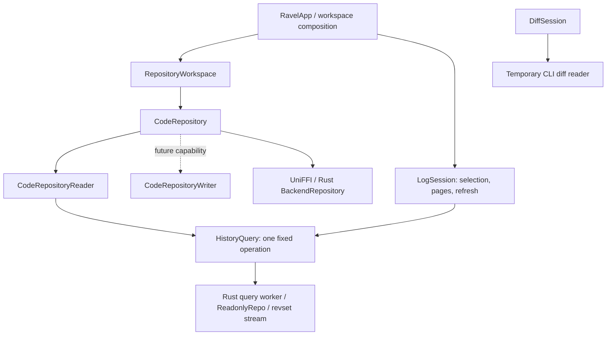

# Repository access and history pagination

Status: history reader implemented; writer contract accepted in design, not yet implemented.

## Ownership

`CodeRepository` is the application access boundary for a workspace, not a feature
session or a database repository. `RepositoryWorkspace` creates, reuses and closes
it. `LogSession` owns presentation state and a history query; it receives an
injected loader and does not know Rust types. `DiffSession` continues to own file
selection and preview state. Native handles and native DTOs stay inside the Swift
adapter. `Revision` and `HistoryPage` are application values; `LogGraph` is derived
presentation data.

Identity has two parts: the canonical workspace root and the canonical backing
repository path. Different jj workspaces can have the same backing repository.
Future writes must share serialization by the latter, not by the window, feature
session, or workspace root. No write queue is added until there is a writer.

## Implemented reader

`CodeRepositoryReader.history(pageSize:)` creates a `HistoryQuery`. The query
pins a `ReadonlyRepo` to a single operation and owns the revset traversal for
`all()`: all visible commits and their ancestors, including root. It ignores
`revsets.log`; abandoned and superseded hidden versions are not added. The
operation also supplies working-copy markers, bookmark labels and divergence
information. Immutable classification uses the official default and configured
revset aliases, including repository/workspace configuration.

Reader opening, refresh and pagination do not snapshot files, import Git refs,
update the working copy, export refs or reconcile concurrent operations. jj may
populate derived object/index caches; read-only here describes repository and
working-copy semantics, not a guarantee of zero filesystem writes. Multiple
operation head pointers produce an error without editing those pointers. The
user can reconcile them in jj and refresh.

Each query has its own worker thread. jj's borrowed, non-Send stream, repository,
configuration and membership evaluator stay on that thread. A request reads one
page plus one lookahead record; it does not materialize all commit IDs or rerun
an ever-growing prefix. The query retains partial-page work and the last
delivered page. Swift retains accepted rows for the table. Memory therefore grows
with displayed rows in Swift; this is pagination, not eviction or unlimited
constant-memory browsing.

A cursor contains the query identity and offset. It is valid only on that query;
Swift rejects foreign query identities and Rust rejects offsets other than the
next cursor or the most recently delivered cursor. A retry of that last cursor
returns the same data. This covers cancellation after Rust delivered a page but
before Swift published it. Native stream errors remain errors rather than
silently skipping a failed stream item. Metadata failures retain the current ID
for retry.

Cancellation uses an explicit native token, checked between metadata operations.
A running jj call cannot be interrupted halfway through an individual object or
tree read. Swift checks task cancellation again before publishing. Query close
signals the worker and waits for cleanup off the main actor; implicit destruction
signals without blocking the actor. Repository close rejects new queries and
closes its registered queries. New read queries can coexist with old read views;
there is no reader-wide global queue.

## Session and table behavior

- Page size is a persisted application preference: 100, 200, 500, 1,000 or 5,000,
  defaulting to 1,000. A query captures its page size when opened; settings changes
  apply on the next refresh or repository open. Scrolling within 20 rows of the
  loaded end requests another page; a manual Load more action is also available.
  Only one page request runs.
- A page failure retains the loaded rows, selection, cursor and query. Automatic
  prefetch stops until explicit Retry or a refresh succeeds.
- Refresh cancels the pending page, creates a new fixed view and reloads at least
  the previously displayed depth. Only a complete successful refresh replaces the
  displayed view. Failure retains the old view and its resumable cursor.
- Every request checks its generation before publishing. An obsolete page cannot
  append into a new repository or refreshed view.
- Selection is preserved by commit ID, then by an unambiguous change ID within
  the refreshed rows, then falls back to the working copy or first row.
- Graph lanes retain pending parents across pages. An unloaded ancestor is a
  continuing edge; the previous filtered-history boundary mode has been removed.
  Appending does not recompute
  existing rows or colors. Root terminates the final lane.
- The native table inserts new rows for the same query and restores a visible-row
  anchor on refresh when that commit is still present. A changed selection may
  intentionally scroll into view.

## Writer contract for the next slice

Reader and writer are capabilities of the same `CodeRepository`. The intended
`CodeRepositoryWriter` is a separate protocol, so read-only consumers cannot
accidentally request mutations. It is not an empty protocol or an implementation
that throws “unsupported” in this slice. Add the executable protocol together with
the first concrete command and its consumers.

The contract of each future command is:

1. Enqueue on the backing repository's write lane. A request cancelled while
   queued has no effect. Keep the lane until the entire operation, required
   working-copy/Git synchronization, and outcome capture are complete.
2. Load current repository state and acquire the relevant jj working-copy lock.
   Cooperate with jj's cross-process locks and operation reconciliation. An
   in-process queue does not exclude terminal jj or Git operations.
3. Perform ordinary jj preprocessing: import external Git state where appropriate,
   handle stale working-copy state according to the command, and snapshot local
   working-copy edits. This is part of write semantics. A prepare-only command is
   explicit; readers never trigger it implicitly.
4. Validate the target and preconditions **after preprocessing**. Commands carry
   the originating read operation and full target commit/change identity. Never
   silently retarget a rewritten or divergent change from a short ID. A conflict
   requiring user choice returns the updated state and a structured reason.
5. Apply the requested mutation in a jj transaction, commit the operation, then
   update the working copy and export/synchronize Git as required by that command.
   A jj transaction is not an atomic transaction over the filesystem and Git.
6. Capture the final outcome and release native resources/locks before allowing
   the next writer. Publish invalidation only after the outcome is known. Existing
   read views remain pinned; feature sessions decide when to refresh them.

The result must preserve phase and effects, including on cancellation or failure:

| Result information | Purpose |
| --- | --- |
| Request ID, workspace identity, initial operation | Correlate a user action and its starting view |
| Preparation operation and whether preparation changed state | Snapshot/import can succeed even when the requested mutation does not run |
| Mutation operation, if committed | Distinguish rejected, failed-before-commit, and committed requests |
| Working-copy and Git synchronization statuses | Represent required, completed, skipped, or failed follow-up work separately |
| Current known operation and affected commit/change identities | Refresh without guessing the new target |
| Cancellation phase and structured failure/recovery details | Explain what happened and what can safely be retried |

Cancellation is a request to stop at a safe boundary, not rollback. After an
operation is committed, a cancellation must not be surfaced as “nothing happened.”
Do not automatically replay a command whose commit outcome is unknown. Writer
execution/outcome ownership belongs to the repository runtime, independent of the
feature task that initiated it; closing a view cannot discard an in-flight write
receipt. On repository close, reject queued/new work, request safe cancellation of
active work, wait for cleanup and preserve its outcome for the composition owner.

The first writer implementation should add tests for preprocessing-only effects,
target changes during preparation, external concurrent operations, cancellation at
each effect boundary, working-copy/export failure after commit, and opening the
same backing repository through multiple workspaces. It should also introduce the
shared backing-repository runtime/queue at that point. This slice adds no write UI,
commands, generic transaction API, remote transport or database layer.

## Integration and remaining transition

The backend pins Rust 1.96.0, jj-lib/jj-cli 0.41.0 and UniFFI 0.32.0. The jj-cli
**library** supplies official configuration layers and alias loading; history does
not launch the jj executable. Keep Cargo.lock checked in and review jj upgrades
as repository-format and semantics changes. Release keeps Rust debug metadata
unstripped to avoid [Rust issue #157750](https://github.com/rust-lang/rust/issues/157750)
with host macro libraries on macOS 27. `Tools/buildBackend` builds the static
archive for Xcode's architectures, and Xcode links it into the app. Generated Swift
bindings/header/module map are checked in. After changing the exported API, run
`Tools/generateBackendBindings` with the pinned toolchain and include the output.

Diff is a deliberate intermediate boundary: it still launches the installed jj
CLI using full commit IDs and `--ignore-working-copy --at-op=<history operation>`.
Its DTO and request are independent of `LogSession`; the selected history query
supplies the operation ID, so a refresh or concurrent external operation does not
silently change the inspector's read context. It loads that operation separately
from the native read view. Migrating changed-file enumeration and patch generation behind
the repository reader is a separate implementation slice. A local jj executable
remains necessary for Diff, not for browsing history. CLI selection preferences
remain until that migration is complete. Changing the executable updates the
inspector request without refreshing the native history query.
