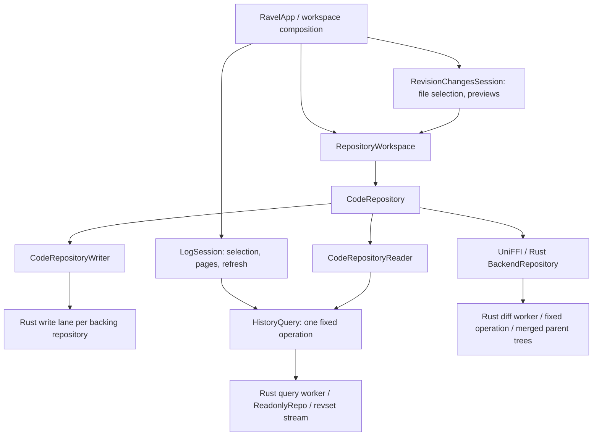

# Repository access and history pagination

History and Diff use pinned read views. Describe, explicit snapshot and local Undo use the repository writer.

## Source organization

`Sources/Ravel/App` composes the application. Business code lives under
`Domains/History`, `Domains/Revision`, `Domains/Settings` and `Domains/Repository`.
Each domain uses the layers that have actual responsibilities:

- `Domain` holds domain values and rules.
- `Application` holds application workflows and their request values.
- `Presentation` holds UI, observable view state and derived display values.
- `Infrastructure` holds native backend adapters and preference storage details.

History and Revision keep their `View` and `ViewModel` folders inside
`Presentation`. `LogSession` and `RevisionChangesSession` retain their existing
lifecycle ownership. `RepositoryLog`, `LogGraph`, diff display rows and the
changed-file tree are derived presentation state, not domain entities. Preference
keys belong to each domain's `Infrastructure`; observable reading options remain
presentation state. Settings binds to the existing owners and needs only `View`.
Localized display extensions and file-status appearance mappings sit directly in
`Presentation`. Revision's file-list feature lives in `Revision/FileList` with
its own `Presentation/View`, `Presentation/ViewModel` and `Presentation/Component`
folders. `RevisionFileListPanel` composes `RevisionFileListHeader` and
`RevisionFileList`. The list displays `RevisionDirectoryRow` and `RevisionFileRow`.
These names identify each component's role. The repository window's root view
keeps the name `RepositoryView` to distinguish the interface from the repository
it displays. `RevisionFileListViewModel` owns filtering and navigation, with
navigation operations in a dedicated extension, expansion state in
`RevisionFileListExpansion`, and tree construction in `ChangedFileTree`.
Tests mirror this feature boundary. File metadata, statistics, status icons and
path-copy support remain in Revision's presentation layer because the preview
also uses them. `RevisionChangesSession` continues to own preview loading and
file selection; navigating to a directory does not replace the previewed file.

The file-list view receives a binding to its display mode; preference storage
remains with the parent inspector. Each FileList view and component has an
interactive `#Preview`, with shared fixtures under `FileList/Preview`. Preview
code is Debug-only and does not open repositories or access user preferences.

`Domains/Repository/Domain` contains shared reader values (`Revision`,
`ChangedFile`, `RevisionDiff` and `FileDiff`). `RepositoryWorkspace` and
`RevisionDiffRequest` live in `Application`; the native `CodeRepository` adapter
lives in `Infrastructure`. `Shared/Presentation` contains the revision summary
presentation used by History and Revision.

The backend file records include before/after type, executable and conflict
metadata. A separate cancellable statistics read returns per-file counts and
aggregate line counts without delaying the first preview. Binary line counts
are absent, not zero. Unchanged inherited conflicts are explicitly distinguished
from modified files.

`RevisionPatchParser` in Infrastructure translates the patch transport into
prefix-free domain lines and structured hunk ranges. `RevisionFilePresentation`
and `RevisionDiffPresentation` map those values into view-specific file rows,
aligned text, ranges and decorations. Views do not interpret patch prefixes.
`RevisionFileListViewModel` owns filtering and expansion. `RevisionChangesSession`
separates requested selection from displayed content, owns the 250 ms progress
policy, and retains a bounded window-scoped preview cache. The AppKit container
owns native text selection and synchronized split scrolling. Each background
surface follows clip-view movement even when TextKit reuses a prefetched layout.

These are organizational boundaries inside one app target. This move does not
enforce dependency inversion or split existing mixed-responsibility files:
`RepositoryWorkspace` still constructs the concrete reader, and that adapter's
file still declares the read/query contracts. Future package extraction needs
explicit interfaces. No placeholder layers are added for future package extraction.

## Ownership

`CodeRepository` is the application access boundary for a workspace, not a feature
session or a database repository. `RepositoryWorkspace` creates, reuses and closes
it. `LogSession` owns presentation state and a history query; it receives an
injected loader and does not know Rust types. `RevisionChangesSession` continues to own file
selection and preview state. Native handles and native DTOs stay inside the Swift
adapter. `Revision` and `HistoryPage` are application values; `LogGraph` is derived
presentation data.

Identity has two parts: the canonical workspace root and the canonical backing
repository path. Different jj workspaces can have the same backing repository.
The native writer keys its queue by the canonical backing repository path.
Each workspace handle owns its admitted requests and completed receipts.

## Implemented reader

`CodeRepositoryReader.history(pageSize:)` creates a `HistoryQuery`. The query
pins a `ReadonlyRepo` to a single operation and owns the revset traversal for
`all()`: all visible commits and their ancestors, including root. It ignores
`revsets.log`; abandoned and superseded hidden versions are not added. The
operation also supplies working-copy markers, bookmark labels and divergence
information. Immutable classification uses the official default and configured
revset aliases, including repository/workspace configuration.

Reader opening, refresh and pagination do not snapshot files, import Git refs,
update the working copy, export refs or reconcile concurrent operations. jj may
populate derived object/index caches; read-only here describes repository and
working-copy semantics, not a guarantee of zero filesystem writes. Multiple
operation head pointers produce an error without editing those pointers. The
user can reconcile them in jj and refresh.

Each query has its own worker thread. jj's borrowed, non-Send stream, repository,
configuration and membership evaluator stay on that thread. A request reads one
page plus one lookahead record; it does not materialize all commit IDs or rerun
an ever-growing prefix. The query retains partial-page work and the last
delivered page. Swift retains accepted rows for the table. Memory therefore grows
with displayed rows in Swift; this is pagination, not eviction or unlimited
constant-memory browsing.

Opening, query initialization, pagination, Diff reads and explicit close are
async UniFFI exports. Swift 6.2+ `@concurrent` adapters await their generated
continuations; they do not synchronously receive a channel result or join a Rust
thread on Swift's cooperative executor. Rust uses oneshot result channels and a
shared cleanup completion. Blocking jj work stays on native workers with 8 MB
stacks and explicit user-initiated QoS on Apple platforms. The history worker's
request receive and jj's internal synchronous waits remain confined to those
workers. Task priority does not automatically propagate across this boundary.

A cursor contains the query identity and offset. It is valid only on that query;
Swift rejects foreign query identities and Rust rejects offsets other than the
next cursor or the most recently delivered cursor. A retry of that last cursor
returns the same data. This covers cancellation after Rust delivered a page but
before Swift published it. Native stream errors remain errors rather than
silently skipping a failed stream item. Metadata failures retain the current ID
for retry.

Cancellation uses an explicit native token, checked between metadata operations.
UniFFI 0.32's Swift async wrapper does not forward task cancellation to the Rust
future, so the adapter retains its cancellation handler and publication checks.
A running jj call cannot be interrupted halfway through an individual object or
tree read. Swift checks task cancellation again before publishing. Query close
signals the worker and asynchronously awaits cleanup; implicit destruction only
signals. Repository close rejects new work, cancels admitted reads and waits for
all their native resources to be released, including queries still initializing
and operations whose callers have stopped waiting. Registration occurs before
the first await. Concurrent/repeated close calls await the same completion; the
completion promises resource release, not that the OS thread has finished its
exit bookkeeping. New read queries can coexist with old read views;
there is no reader-wide global queue.

## Session and table behavior

- Page size is a persisted application preference: 100, 200, 500, 1,000 or 5,000,
  defaulting to 1,000. A query captures its page size when opened; settings changes
  apply on the next refresh or repository open. Scrolling within 20 rows of the
  loaded end requests another page; a manual Load more action is also available.
  Only one page request runs.
- A page failure retains the loaded rows, selection, cursor and query. Automatic
  prefetch stops until explicit Retry or a refresh succeeds.
- Refresh cancels the pending page, creates a new fixed view and reloads at least
  the previously displayed depth. Only a complete successful refresh replaces the
  displayed view. Failure retains the old view and its resumable cursor.
- Every request checks its generation before publishing. An obsolete page cannot
  append into a new repository or refreshed view.
- Selection is preserved by commit ID, then by an unambiguous change ID within
  the refreshed rows, then falls back to the working copy or first row.
- Graph lanes retain pending parents across pages. An unloaded ancestor is a
  continuing edge; the previous filtered-history boundary mode has been removed.
  Appending does not recompute
  existing rows or colors. Root terminates the final lane.
- The native table inserts new rows for the same query and restores a visible-row
  anchor on refresh when that commit is still present. A changed selection may
  intentionally scroll into view.

## Writer contract

`CodeRepositoryWriter` adds Describe, snapshot and local Undo to the same
`CodeRepository` that supplies the readers. Feature sessions route requests
through `RepositoryWorkspace`.

1. Enqueue on the backing repository's write lane. A request cancelled while
   queued has no effect. Keep the lane until the entire operation, required
   working-copy/Git synchronization, and outcome capture are complete.
2. Load current repository state and acquire the relevant jj working-copy lock.
   Cooperate with jj's cross-process locks and operation reconciliation. An
   in-process queue does not exclude terminal jj or Git operations.
3. Perform ordinary jj preprocessing: import external Git state where appropriate,
   handle stale working-copy state according to the command, and snapshot local
   working-copy edits. This is part of write semantics. A prepare-only command is
   explicit; readers never trigger it implicitly.
4. Validate the target and preconditions **after preprocessing**. Commands carry
   the originating read operation and full target commit/change identity. Never
   silently retarget a rewritten or divergent change from a short ID. A conflict
   requiring user choice returns the updated state and a structured reason.
5. Apply the requested mutation in a jj transaction, commit the operation, then
   update the working copy and export/synchronize Git as required by that command.
   A jj transaction is not an atomic transaction over the filesystem and Git.
6. Capture the final outcome and release native resources/locks before allowing
   the next writer. Publish invalidation only after the outcome is known. Existing
   read views remain pinned; feature sessions decide when to refresh them.

The result must preserve phase and effects, including on cancellation or failure:

| Result information | Purpose |
| --- | --- |
| Request ID, workspace identity, initial operation | Correlate a user action and its starting view |
| Preparation operation and whether preparation changed state | Snapshot/import can succeed even when the requested mutation does not run |
| Mutation operation, if committed | Distinguish rejected, failed-before-commit, and committed requests |
| Working-copy and Git synchronization statuses | Represent required, completed, skipped, or failed follow-up work separately |
| Current known operation and affected commit/change identities | Refresh without guessing the new target |
| Cancellation phase and structured failure/recovery details | Explain what happened and what can safely be retried |

Cancellation is a request to stop at a safe boundary, not rollback. After an
operation is committed, a cancellation must not be surfaced as “nothing happened.”
Do not automatically replay a command whose commit outcome is unknown. Writer
execution/outcome ownership belongs to the repository runtime, independent of the
feature task that initiated it; closing a view cannot discard an in-flight write
receipt. On repository close, reject queued/new work, request safe cancellation of
active work, wait for cleanup and preserve its outcome for the composition owner.

### Calling the local writer

Capture `RevisionWriteTarget(workspaceURL:operationID:commitID:changeID:)` from
the clicked row and its displayed history query. Pass it to
`RepositoryWorkspace.describe(_:title:body:)`. The adapter joins the title and
multiline body with a blank line. A successful receipt identifies the selected
change and its resulting commit. An unrelated operation can advance the head
while keeping that target valid. A changed target, including a working copy
rewritten during preparation, returns `.staleTarget` with the current operation
for review. A committed mutation with failed checkout or Git export returns
`.committedWithSyncFailure`. Its mutation ID remains available.

`snapshot(at:operationID:)` performs preparation on the same queue. A clean
working copy produces no new operation. For focus handling,
`snapshotIfIdle(at:operationID:)` atomically skips a busy backing repository
and returns nil. The presentation owner controls window visibility and Split
selection. `isWriting(at:)` reports activity shared by sibling workspaces.

`operationHistory(at:limit:)` reads the local operation DAG and returns its
head and the actual next Undo target. Pass that exact history value to
`undo(_:)` after confirmation. Undo rechecks the displayed head after
preparation and accounts for earlier Undo and Git synchronization operations.
The repository toolbar offers explicit snapshot and local operation history.

The writer uses jj's colocated Git import/export lock, the workspace lock and
the operation-head lock. It reads the current head under the locks, imports
external Git state, snapshots with configured ignores and auto-tracking,
and publishes each completed phase. Concurrent heads and stale working copies
return separate recovery reasons. A completed request stays available through
`takeWriteReceipts()`, including after the workspace switches or closes.
Quitting the app waits for repository cleanup.

## Integration and remaining transition

The backend pins Rust 1.96.0, jj-lib/jj-cli 0.41.0 and UniFFI 0.32.0. The jj-cli
**library** supplies official configuration layers, alias loading, copy records
and Git patch rendering. No application read launches the jj executable or an
external diff tool. Keep Cargo.lock checked in and review jj upgrades
as repository-format and semantics changes. Release keeps Rust debug metadata
unstripped to avoid [Rust issue #157750](https://github.com/rust-lang/rust/issues/157750)
with host macro libraries on macOS 27. `Tools/buildBackend` builds the static
archive for Xcode's architectures, and Xcode links it into the app. Generated Swift
bindings/header/module map are checked in. After changing the exported API, run
`Tools/generateBackendBindings` with the pinned toolchain and include the output.

`CodeRepositoryReader.diff` and `fileDiff` require an explicit operation ID and
full commit ID. `RepositoryWorkspace` routes requests only to its current
repository; an obsolete request cannot reopen a previous workspace. The selected
history query supplies the operation ID. Each native Diff call loads that exact
operation independently, so concurrent external heads do not change the view or
trigger reconciliation. Swift receives typed changed-file records and a bounded
Git patch; native objects stay on the worker. The app composition injects both
feature sessions with this same workspace owner.

Diff compares a commit against the automatic merge of all its parents. Copy
records preserve rename/copy identity. A file request uses an exact repository
path, with no shell or fileset interpolation. Built-in patch rendering ignores
external formatter configuration and preserves the existing three-line context,
binary, conflict, permission and missing-newline behavior. Swift still derives
line numbers and presentation from the patch.

Repository close rejects new Diff calls, cancels active reads and waits for their
workers to release resources. Cancellation is checked between repository/tree
phases, while enumerating entries, and on patch output writes. An individual jj
tree merge or content-diff calculation is not interruptible; close waits for it
to reach the next check. Patch output is bounded to fewer than 2 MB and at most
20,000 lines; limits fail the preview without publishing a partial patch.

`JJClient`, executable-selection UI/preferences and the Swift Subprocess package
have been removed. Tests alone launch jj to build fixtures and provide an
independent comparison; end users do not need a jj executable for these readers.
