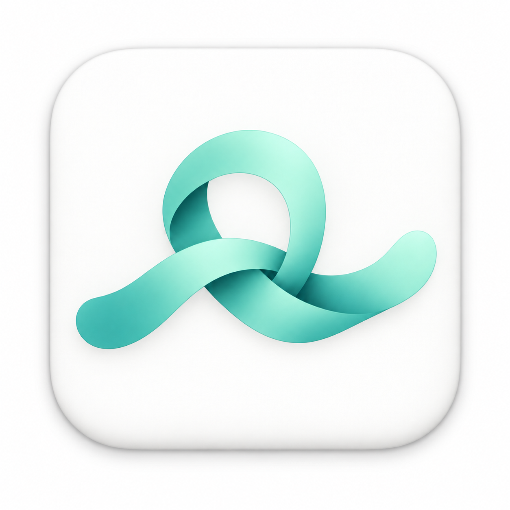

# Ravel

<picture>
  <source media="(prefers-color-scheme: dark)" srcset="Artwork/ravel-icon-dark.png">
  
</picture>

A native Jujutsu client for Mac.

Ravel is an early, read-only prototype with a Fork-inspired history layout.
The current milestone is browsing a workspace's graph and understanding each
revision's changes. The architecture is still evolving; there is no tagged release
or packaged installer yet.

Ravel opens an existing jj workspace and shows its revision graph, descriptions,
bookmarks, authors, and timestamps in a native table. Select a revision to see its
changed files and a unified diff, or switch to Details for its full description
and identity. The last successfully opened workspace is restored at launch.

## Build and run

- macOS 15 or later
- Xcode 26 or later with Swift 6.2 or later
- Rust 1.96.0 through rustup (pinned in `Backend/rust-toolchain.toml`)
- Jujutsu (`jj`) 0.41 or later for the Diff inspector and integration fixtures

Open `Ravel.xcodeproj`, select the **Ravel** scheme, and run. Swift Package Manager
resolves Swift Subprocess 1.0.0. The build phase runs `Tools/buildBackend` and
statically links jj-lib 0.41.0 through UniFFI. The first build downloads Cargo
dependencies. For a universal Release build, install both Rust targets:
`rustup target add --toolchain 1.96.0 aarch64-apple-darwin x86_64-apple-darwin`.
The app uses local ad-hoc signing and does not require a development team.

Choose **File → Open Repository…** (`⌘O`) and select an existing jj workspace.
Refresh with `⌘R`, or return to the app after working in the terminal. `⌘0` selects
the working-copy revision. The Ravel menu includes **Choose jj Executable…** for
installations outside the usual Homebrew/PATH locations.

An explicit workspace can also be provided when launching the built app:

```sh
open /path/to/Ravel.app --args --repository /path/to/workspace
```

## Current implementation

- SwiftUI owns the window, sidebar, toolbar, and details.
- AppKit owns the table, selection, and graph rendering.
- The Changes inspector lists added, modified, removed, copied, and renamed files.
  File contents load on selection, with separate old/new line-number gutters,
  addition/deletion colors, and native text selection and copying. Gutters are
  excluded from copied text. Details remains available beside Changes.
- Rust owns a fixed-operation history view and demand-driven revset traversal.
  `CodeRepositoryReader` and `HistoryQuery` expose application values to Swift.
- Pure Swift incrementally assigns graph lanes, retaining parents across pages.
- The existing Diff adapter uses Swift Subprocess with direct argument arrays.
- Window state is `@MainActor` and observable. Native calls run off the main actor;
  cancellation tokens and generation checks prevent replaced requests from
  publishing stale pages.

Swift 6 language mode, complete concurrency checking, MainActor default isolation,
and approachable concurrency are enabled in `Config/Concurrency.xcconfig`.
`nonisolated` value types explicitly cross the UI boundary. UI and session models
retain checked actor isolation. UserDefaultsKit contains one internal, immutable
`@unchecked Sendable` bridge for Foundation's documented thread-safe UserDefaults;
its Store and accessors otherwise use checked Sendable conformances.

History loads all visible commits and their ancestors, down to the root commit,
in jj's topological order. It ignores `revsets.log` and excludes abandoned or
superseded hidden versions. Settings offers batches of 100, 200, 500, 1,000 or
5,000 revisions, with 1,000 as the default; changes apply on the next refresh or
repository open. Scrolling near the loaded end requests the next page.
Loading more preserves selection and existing graph
rows. Page failures keep the cursor for explicit Retry. Refresh replaces the view
only after successfully reading the previously loaded depth.

Read access does not snapshot files, import Git refs, update the working copy, or
merge concurrent operations. Editor changes appear after jj records them.
Concurrent operation heads are reported for the user to handle in jj. Every
history query pins one operation, so external repository changes cannot mix pages
from different views.

Diffs use the selected full commit ID and jj's `diff --revisions` semantics,
including comparison against the automatic merge of all parents for a merge
revision. The file list is decoded from explicit JSON fields; file previews use
an escaped exact path fileset and the built-in Git diff format. Both revision and
file requests are cancelled on replacement, with generation checks preventing
obsolete results from appearing. Binary files and empty revisions have explicit
states; mode-only changes remain visible. Each file preview is limited to 2 MB
or 20,000 lines, with an error instead of a partial patch.

Refreshing an unchanged commit keeps the loaded file and reading position.

History uses the bundled Rust backend; Diff still requires a locally installed jj.
Diff requests carry the history operation ID as well as the full commit ID. The
macOS target remains non-sandboxed to access repositories and the executable.

The accepted reader/writer ownership, write preprocessing and cancellation
contract, integration details, and remaining Diff migration are documented in
[Repository architecture](Documentation/RepositoryArchitecture.md). No write
commands or write UI are implemented in this slice.

### Code map

| Entry | Responsibility |
| --- | --- |
| `Sources/Ravel/RavelApp.swift` | Window lifetime, commands, repository and executable panels |
| `Sources/Ravel/Log/LogSession.swift` | Loaded pages, selected revision, recents, refresh and retry state |
| `Sources/Ravel/UserDefaultsKeys.swift` | Shared declarations of typed business keys and defaults |
| `Sources/Ravel/Repository/` | Workspace lifetime, repository reader, query cursor and CLI compatibility adapter |
| `Sources/Ravel/Log/LogGraph.swift` | Lane assignment and edges for the loaded revision set |
| `Sources/Ravel/Diff/` | Changed-file queries, patch parsing and cancellable diff state |
| `Sources/Ravel/UI/` | SwiftUI composition, AppKit history table, graph and text diff rendering |
| `Backend/` | Pinned jj-lib, read-only operation views and streaming history queries |
| `Packages/RavelBackend/` | Generated UniFFI Swift declarations and C module |
| `Packages/Logger/` | Native system loggers with a shared subsystem convention |
| `Packages/UserDefaultsKit/` | Typed storage, plain property wrapper and optional Observation macro |
| `Tests/RavelTests/` | Swift Testing unit and temporary-repository integration tests |

These are the current ownership boundaries, not a final architecture proposal.

Diagnostics use the local [Logger package](Packages/Logger/). Repository refreshes
and jj invocations record events and diagnostic fields under the `com.weixi.Ravel`
subsystem. Each package can create its own logger without application setup.

## Localization

Product copy is maintained in a single catalog in the local [Localization package](Packages/Localization/).
It supports nine languages and exposes `I18n` accessors generated by Apple’s string
catalog tool. After editing the catalog, run `Tools/updateLocalization`; new copy
does not require hand-written accessors or changes to the generator.

## Development workflow

This checkout uses jj colocated with Git. After cloning elsewhere, initialize the
local metadata once:

```sh
jj git init --colocate
jj bookmark track main --remote origin
```

Configure your own jj author identity if needed. For a small, coherent change, use
`jj describe -m "type(scope): describe the change"` to name it, then `jj new` to
start the next change. Use `jj split` to separate mixed work before publishing.
Fetch and inspect the graph before moving or pushing the intended bookmark.

CodeGraph is optional development tooling, not an app dependency. With its CLI
installed, create a local index from the repository root:

```sh
codegraph init -i
```

CodeGraph-enabled tools can then query this repository by its local project path.
The index is disposable and may lag edits; the compiler and tests verify behavior.
`.jj/`, `.codegraph/`, build outputs, test result bundles, and Xcode user state are
ignored. The Xcode project, shared scheme, and `Package.resolved` are tracked.

## What remains

The next milestones are open for discussion, rather than a fixed delivery plan:

- Migrate changed-file queries and patch generation from the CLI to the repository reader.
- Add history search and filtering without confusing filtered edges with unloaded parents.
- Detect repository changes while the window stays active.
- Improve diff navigation, large-file handling and side-by-side presentation.
- Implement the first writer against the documented preparation, serialization and outcome contract.
- Decide on jj distribution, app sandboxing, signing, notarization and updates.

## Artwork

The approved dark icon and its white-background companion live in [Artwork](Artwork/).
While Ravel is running, its Dock icon follows **System Settings → Appearance**
directly: light appearance uses the white tile, dark appearance uses the dark tile.
No separate icon-style setting is needed for the running app's Dock icon.

[AppIcon.icon](Sources/Ravel/Resources/AppIcon.icon) supplies the system-managed
icon in Finder and when Ravel is not running. On macOS 26 and later, those surfaces
follow **Icon & widget style**, which is separate from window appearance. Earlier
macOS versions use the static compatibility icon generated by Xcode.
The README follows the reader's color scheme.
The light variant keeps the teal ribbon knot and changes the tile to white;
generation and integration details are recorded in [Artwork/README.md](Artwork/README.md).

## Verify

```sh
Tools/testBackend
xcodebuild -project Ravel.xcodeproj -scheme Ravel \
  -destination 'platform=macOS' -derivedDataPath .build/DerivedData test
```

Swift Testing covers graph continuity, merges, hidden ancestry, divergent changes,
version checks, stale pages, retry cursors, failed refreshes, diff hunk line
numbers, CRLF, missing final newlines, and preview limits. CLI integration tests
use isolated temporary repositories and run when `/opt/homebrew/bin/jj` is
available. They cover rename and mode changes, binary files, special filenames,
and merge semantics, and verify that reading leaves both the working directory
and operation history unchanged.

Rust integration tests traverse more than 450 commits through root, verify fixed
views across external operations, replay after cancellation, read-only state,
concurrent-operation errors and close behavior. `Tools/testBackend` isolates jj
configuration; set `RAVEL_TEST_JJ` to override the fixture executable. Swift tests
also compare the real Rust bridge output against CLI metadata.

After changing the native interface, run `Tools/generateBackendBindings` and
include its generated Swift/header/module-map changes. Both native and Swift
callers must be built from the same interface version.

The Dock icon regression test changes only the test host's appearance. It checks
light/dark updates, resizing while detached from a window, nontransparent rendered
pixels, and observer cleanup. These checks run on macOS 27; desktop Dock rendering
still needs visual verification after changes to this integration.

The initial history-and-diff milestone passed 29 test executions and Debug/Release
builds on macOS 26.5.1, Xcode 26.6 and Swift 6.3.3 with jj 0.41.0. The code targets
Swift 6.2 concurrency semantics; a Swift 6.2 compiler has not been tested separately.
